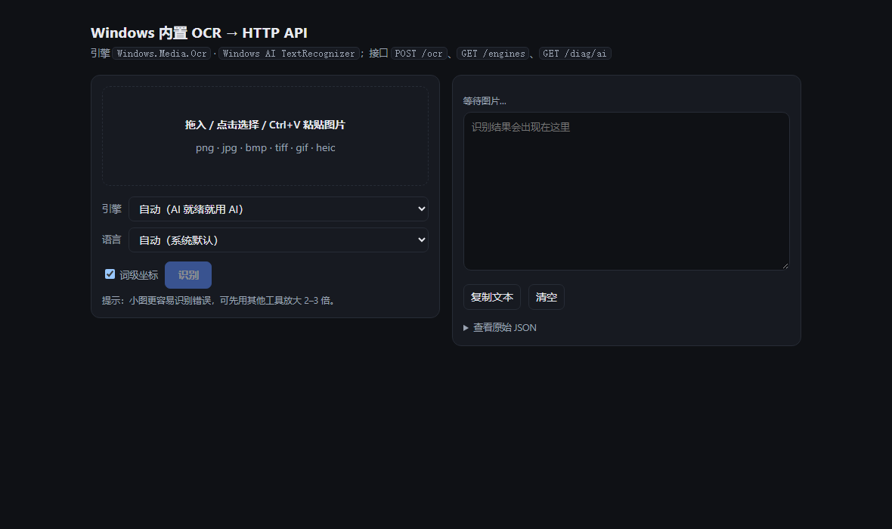

# Windows OCR API

**English** · [简体中文](README.zh-CN.md)

[](LICENSE)
[](https://dotnet.microsoft.com/)
[](#requirements)
[](CONTRIBUTING.md)

A local HTTP service that wraps the OCR engines already installed on Windows, so anything that can make an HTTP
request can read text out of an image — no cloud calls, no API key, no separate model download for the classic engine.

```console
$ curl.exe -s --data-binary "@sample.png" "http://127.0.0.1:8737/ocr?format=text"
骁龙 X Elite 内置 OCR 测试
```



## Engines

| Engine | Implementation | Status |
| --- | --- | --- |
| `windows` | [`Windows.Media.Ocr`](https://learn.microsoft.com/uwp/api/windows.media.ocr) — the same OCR behind the Snipping Tool, pure CPU | ✅ Works out of the box |
| `ai` | [`Microsoft.Windows.AI.Imaging.TextRecognizer`](https://learn.microsoft.com/windows/ai/apis/text-recognition) — the NPU model on Copilot+ PCs | ✅ Works when installed as a signed package ([setup](docs/ai-engine.md)); noticeably cleaner output |

When the AI engine is available it is the better one: the classic engine splits Chinese into words and joins them
with spaces, and misreads some Latin words; the NPU model returns `骁龙 X Elite 内置 OCR 测试` and `Copilot+ PC`
as-is.

The `auto` engine uses the AI model when it is already loaded and ready, and otherwise falls back to
`Windows.Media.Ocr`. It never triggers a model download behind your back.

## Requirements

- Windows 10 version 2004 (build 19041) or later. Windows 11 recommended.
- [.NET 10 SDK](https://dotnet.microsoft.com/download/dotnet/10.0) to build; the published output only needs the
  [.NET 10 Desktop Runtime](https://dotnet.microsoft.com/download/dotnet/10.0) and the Windows App SDK runtime
  (already present on up-to-date Windows 11).
- At least one OCR language pack. Check with `GET /languages` after starting the service.

The AI engine additionally needs a Copilot+ PC, Windows App SDK 2.6.5, and the service **installed as a signed
package** — a plain `dist\WinOcrApi.exe` has no package identity and `systemAIModels` stays denied. The full recipe
is in [docs/ai-engine.md](docs/ai-engine.md); in short:

```powershell
.\publish.ps1
.\package\build-msix.ps1        # self-signs a dev certificate and packs out\WinOcrApi.msix

# elevated, once:
Import-Certificate -FilePath .\out\WinOcrApi.cer -CertStoreLocation Cert:\LocalMachine\TrustedPeople
Add-AppxPackage .\out\WinOcrApi.msix

# then start it with package identity:
Start-Process explorer.exe "shell:AppsFolder\$((Get-AppxPackage WinOcrApi).PackageFamilyName)!WinOcrApi"
```

`GET /diag/ai` reports `packaged: true`, `signature: Developer` and `capability.access: Allowed` when it is
working.

## Quick start

```powershell
# Run from source
.\start.cmd
# or
dotnet run --project WinOcrApi.csproj -c Release

# Publish a framework-dependent build under dist\ (architecture is auto-detected)
.\publish.ps1
.\dist\WinOcrApi.exe
```

The service listens on `http://127.0.0.1:8737`. Open it in a browser and you get a drag-and-drop page
(paste with <kbd>Ctrl</kbd>+<kbd>V</kbd>, pick the engine and language, copy the text back out).

```powershell
# Self-check without starting the server: package identity, AI state, both engines on a sample image
.\dist\WinOcrApi.exe --selftest sample.png
```

## API

### `POST /ocr`

Send the image bytes as the request body (raw, `multipart/form-data` with a `file` field, or as a
`?url=` the server downloads itself). Supported formats: PNG, JPEG, BMP, TIFF, GIF, HEIC.

| Parameter | Default | Meaning |
| --- | --- | --- |
| `engine` | `auto` | `auto` / `windows` / `ai`. `auto` only uses the AI model when it is already ready |
| `lang` | system default | Classic engine only. Accepts `zh`, `zh-Hans`, `zh-CN`, `en-US` style tags |
| `clean` | `false` | Remove the spaces the classic engine inserts between CJK characters |
| `words` | `true` | Include word-level bounding boxes (the AI engine also returns `confidence`) |
| `lines` | `true` | Include the line array |
| `scale` | `1.0` | Resize before recognition, `0.05`–`4.0` |
| `rotate` | `0` | Rotate clockwise by `90`, `180` or `270` degrees |
| `format` | `json` | `text` returns plain text instead of JSON |
| `url` | — | Let the server fetch the image from this URL (GET and POST both work) |

```json
{
  "ok": true,
  "text": "骁龙 X Elite 内置 OCR 测试\n…",
  "engine": "windows",
  "language": "zh-Hans-CN",
  "languageName": "简体中文(中国大陆)",
  "width": 960,
  "height": 420,
  "lineCount": 5,
  "wordCount": 60,
  "elapsedMs": 43.7,
  "totalMs": 73.2,
  "bytes": 42701,
  "lines": [
    { "text": "骁龙 X Elite 内置 OCR 测试", "x": 40, "y": 40, "width": 503, "height": 38, "words": null }
  ]
}
```

With `engine=ai`, `language` is `ai` (the model is multilingual and does not take a language hint) and
`words[].confidence` comes from `MatchConfidence`.

### Other endpoints

| Endpoint | Purpose |
| --- | --- |
| `GET /health` | Version, both engines' state, default language, image dimension limit |
| `GET /engines` | Per-engine availability details and the classic engine's language list |
| `GET /languages` | Installed classic-engine OCR languages |
| `GET /diag/ai` | Package identity, signature kind, result of each Windows AI API probe |
| `GET /` | The drag-and-drop test page |

### Status codes

| Code | Meaning |
| --- | --- |
| 400 | Empty body, unsupported language, unknown `engine` value |
| 401 | `OCR_API_TOKEN` is set but the request carries no/wrong token |
| 413 | Image larger than 64 MB |
| 422 | The image could not be decoded |
| 499 | The client disconnected before the result was ready |
| 502 | `?url=` download failed |
| 503 | `engine=ai` was requested but the AI engine is not available (reason in the body) |

Error bodies are always `{ "ok": false, "error": "…" }`.

## Examples

```powershell
# Plain text, CJK spacing cleaned up
Invoke-RestMethod -Uri 'http://127.0.0.1:8737/ocr?clean=true&format=text' -Method Post -InFile .\a.png

# Force the classic engine, English, no word boxes
Invoke-RestMethod -Uri 'http://127.0.0.1:8737/ocr?engine=windows&lang=en-US&words=false' -Method Post -InFile .\a.png

# In PowerShell 7 curl is an alias for Invoke-WebRequest, call curl.exe explicitly
curl.exe -s -H "Content-Type: image/png" --data-binary "@a.png" "http://127.0.0.1:8737/ocr?clean=true"
```

```python
import requests

with open("a.png", "rb") as f:
    r = requests.post("http://127.0.0.1:8737/ocr", params={"clean": "true"}, data=f)
print(r.json()["text"])
```

## Configuration

| What | How |
| --- | --- |
| Port / bind address | `WinOcrApi.exe --urls http://127.0.0.1:9000`, or the `OCR_API_URLS` environment variable |
| LAN access | `--urls http://0.0.0.0:8737` — read [Security](#security) first |
| Simple auth | Set `OCR_API_TOKEN=…`; clients send `X-Api-Key: …` or `Authorization: Bearer …` |
| AI engine | Install as a signed package: `.\publish.ps1`, `.\package\build-msix.ps1`, trust the `.cer`, `Add-AppxPackage` — see [docs/ai-engine.md](docs/ai-engine.md) |
| Start on login | Drop a shortcut to `start.cmd` (or the packaged launch) into `shell:startup` |
| Rebuild | `.\publish.ps1` — `win-arm64` / `win-x64` are auto-detected, override with `-Runtime` |
| MSIX + self-signed install | `.\package\build-msix.ps1` (see [docs/ai-engine.md](docs/ai-engine.md)) |

## Performance

Measured on a Surface Pro 11 (Snapdragon X Elite), 960×420 mixed Chinese/English image, warm process:

| Scenario | Result |
| --- | --- |
| Classic engine, 960×420 | 38 ms, 5 lines, 60 words |
| AI engine (NPU), 960×420 | 147 ms, 5 lines, 41 words, correct CJK spacing |
| Classic engine, 1920×1216 desktop screenshot | 212 ms, 63 lines |
| Classic engine, 2400×1600 Chinese document | 173 ms, 34 lines |
| Classic engine, 8 concurrent (2400×1600) | all succeeded in 1.65 s (serialized per language) |

`OcrEngine` is not thread-safe, so requests are queued per language; different languages run in parallel. The AI
engine is slower per image but needs no language selection and needs no `clean=true` post-processing.

## Code map

```
WinOcrApi.csproj            # net10.0-windows10.0.19041.0 + WindowsAppSDK.AI 2.6.5
Program.cs                  # HTTP layer: routes, query parsing, auth, errors, --selftest
OcrRouter.cs                # engine selection + package identity check
OcrService.cs               # classic engine (Windows.Media.Ocr), one gate per language
AiTextRecognizerEngine.cs   # AI engine (TextRecognizer) + the /diag/ai probes
ImageDecoder.cs             # image bytes -> BGRA8 SoftwareBitmap (resize / rotate)
OcrModels.cs                # result records and exception types
wwwroot/index.html          # drag-and-drop test page
package/                    # sparse package manifest + register/launch/msix scripts
docs/                       # AI engine write-up, publishing notes, screenshots
start.cmd, publish.ps1      # run / publish
```

## Known limitations

- **Spaces inside Chinese text (classic engine)** — it splits CJK text per word and joins with spaces. `clean=true`
  removes the spaces between CJK characters while keeping Latin ones. The AI engine does not have this problem.
- **Latin accuracy is mediocre (classic engine)** — `Copilot` comes back as `CopiIot`. Long-standing
  `Windows.Media.Ocr` behaviour; pass `?lang=en-US` for English-only images and it improves noticeably, or use the
  AI engine.
- **One engine per language, serialized** — concurrent requests in the same language queue up.
- **The AI engine needs a signed install** — running `dist\WinOcrApi.exe` directly has no package identity, so
  `systemAIModels` stays denied and `auto` falls back to the classic engine. Install the MSIX as described in
  [docs/ai-engine.md](docs/ai-engine.md).
- **Model download is opt-in** — `auto` never triggers it. `--selftest` does, when the model is not ready yet, and
  the first download can take minutes.
- **Whole body in memory** — uploads are buffered in memory (64 MB cap), never written to disk. Temp directories may
  be unwritable under restricted accounts, which is why.
- **Single user, single process** — no rate limiting, no per-user quotas, no job queue.

## Security

This is a local helper, not a hardened network service. It binds to `127.0.0.1` by default and has no
authentication unless you set `OCR_API_TOKEN`. Do not expose it to the internet. If you must reach it from the LAN,
set a token and remember that `?url=` makes the server fetch arbitrary URLs (SSRF). Details and reporting:
[SECURITY.md](SECURITY.md).

## Contributing

Issues and pull requests are welcome, in English or Chinese. Please read [CONTRIBUTING.md](CONTRIBUTING.md) and the
[changelog](CHANGELOG.md) first.

## License

Copyright (C) 2026 ChakerAt.
Licensed under [GNU General Public License v3.0](LICENSE)