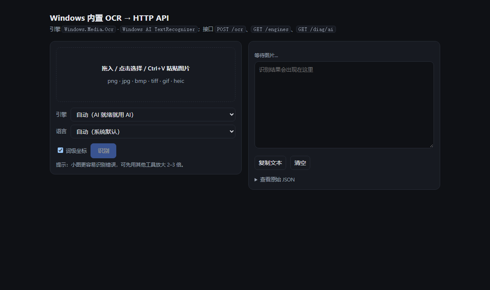

# Windows OCR API

[English](README.md) · **简体中文**

[](LICENSE)
[](https://dotnet.microsoft.com/)
[](#环境要求)
[](CONTRIBUTING.md)

把 Windows 自带的 OCR 引擎包成一个本地 HTTP 服务：任何能发 HTTP 请求的东西都能从图片里取文字。传统引擎不用连云、不用 API Key、不用额外下载模型。

```console
$ curl.exe -s --data-binary "@sample.png" "http://127.0.0.1:8737/ocr?format=text"
骁龙 X Elite 内置 OCR 测试
```



## 两套引擎

| 引擎 | 实现 | 状态 |
| --- | --- | --- |
| `windows` | [`Windows.Media.Ocr`](https://learn.microsoft.com/uwp/api/windows.media.ocr)（截图工具「提取文本」同一套，纯 CPU） | ✅ 开箱即用 |
| `ai` | [`Microsoft.Windows.AI.Imaging.TextRecognizer`](https://learn.microsoft.com/windows/ai/apis/text-recognition)（Copilot+ PC 的 NPU 模型） | ✅ 以签名包安装后可用（[步骤](docs/ai-engine.zh-CN.md)），输出明显更干净 |

AI 引擎能用的时候它更好：传统引擎会把中文按词切开再用空格拼回来、偶尔把拉丁字母认错；NPU 模型直接给出
`骁龙 X Elite 内置 OCR 测试` 和 `Copilot+ PC`。

`auto` 只在 AI 模型已经就绪时用它，否则回落到传统引擎；不会为了一个请求去触发模型下载。

## 环境要求

- Windows 10 2004（build 19041）或更高，推荐 Windows 11。
- 编译需要 [.NET 10 SDK](https://dotnet.microsoft.com/download/dotnet/10.0)；发布产物只需要
  [.NET 10 Desktop Runtime](https://dotnet.microsoft.com/download/dotnet/10.0) 和 Windows App SDK 运行时
  （较新的 Windows 11 自带）。
- 至少装一个 OCR 语言包。启动后访问 `GET /languages` 即可确认。

AI 引擎另有要求：Copilot+ PC、Windows App SDK 2.6.5，并且服务必须以**签名包**安装——直接跑 `dist\WinOcrApi.exe`
没有包身份，`systemAIModels` 会被拒。完整步骤见 [docs/ai-engine.zh-CN.md](docs/ai-engine.zh-CN.md)，简版：

```powershell
.\publish.ps1
.\package\build-msix.ps1        # 自签开发证书并打包 out\WinOcrApi.msix

# 管理员 PowerShell，只需一次：
Import-Certificate -FilePath .\out\WinOcrApi.cer -CertStoreLocation Cert:\LocalMachine\TrustedPeople
Add-AppxPackage .\out\WinOcrApi.msix

# 之后带包身份启动：
Start-Process explorer.exe "shell:AppsFolder\$((Get-AppxPackage WinOcrApi).PackageFamilyName)!WinOcrApi"
```

可用时 `GET /diag/ai` 会显示 `packaged: true`、`signature: Developer`、`capability.access: Allowed`。

## 快速开始

```powershell
# 从源码直接跑
.\start.cmd
# 或
dotnet run --project WinOcrApi.csproj -c Release

# 打包到 dist\（架构自动识别）
.\publish.ps1
.\dist\WinOcrApi.exe
```

服务默认监听 `http://127.0.0.1:8737`。浏览器打开有拖拽识别页面：拖图或 <kbd>Ctrl</kbd>+<kbd>V</kbd> 粘贴，选引擎和语言，结果可一键复制。

```powershell
# 不启服务也能自检：打印包身份、AI 状态，再拿样图跑两个引擎
.\dist\WinOcrApi.exe --selftest sample.png
```

## 接口

### `POST /ocr`

图片字节放请求体（裸字节 / `multipart` 的 `file` 字段 / `?url=` 让服务端自己下载）。支持 PNG、JPEG、BMP、TIFF、GIF、HEIC。

| 参数 | 默认 | 说明 |
| --- | --- | --- |
| `engine` | `auto` | `auto` / `windows` / `ai`。`auto` 只在 AI 模型已就绪时用 AI |
| `lang` | 跟随系统 | 仅传统引擎用；支持 `zh`、`zh-Hans`、`zh-CN`、`en-US` 这类简写 |
| `clean` | `false` | 去掉中文汉字之间多余的空格（传统引擎需要） |
| `words` | `true` | 是否返回词级包围盒（AI 引擎额外带 `confidence`） |
| `lines` | `true` | 是否返回行数组 |
| `scale` | `1.0` | 识别前缩放，`0.05`–`4.0` |
| `rotate` | `0` | 顺时针旋转 90 / 180 / 270 度 |
| `format` | `json` | 填 `text` 返回纯文本 |
| `url` | — | 服务端下载该 URL 的图片，GET/POST 都行 |

```json
{
  "ok": true,
  "text": "骁龙 X Elite 内置 OCR 测试\n…",
  "engine": "windows",
  "language": "zh-Hans-CN",
  "languageName": "简体中文(中国大陆)",
  "width": 960,
  "height": 420,
  "lineCount": 5,
  "wordCount": 60,
  "elapsedMs": 43.7,
  "totalMs": 73.2,
  "bytes": 42701,
  "lines": [
    { "text": "骁龙 X Elite 内置 OCR 测试", "x": 40, "y": 40, "width": 503, "height": 38, "words": null }
  ]
}
```

`engine=ai` 时 `language` 为 `ai`（模型多语言，不接受语言提示），`lines[].words[].confidence` 来自 `MatchConfidence`。

### 其他接口

| 接口 | 用途 |
| --- | --- |
| `GET /health` | 版本、两个引擎状态、默认语言、单图尺寸上限 |
| `GET /engines` | 每个引擎的可用性细节，传统引擎的语言列表 |
| `GET /languages` | 传统引擎已安装的语言 |
| `GET /diag/ai` | 包身份、签名类型、逐个 Windows AI API 的探测结果 |
| `GET /` | 拖拽测试页 |

### 状态码

| 状态码 | 含义 |
| --- | --- |
| 400 | 请求体为空、语言不支持、`engine` 值不认识 |
| 401 | 配了 `OCR_API_TOKEN` 但没带或带错 |
| 413 | 图片超过 64 MB |
| 422 | 图片解不开 |
| 499 | 客户端在结果出来前断开 |
| 502 | `?url=` 下载失败 |
| 503 | 指定 `engine=ai` 但 AI 引擎不可用（body 里带原因） |

错误响应统一为 `{ "ok": false, "error": "…" }`。

## 示例

```powershell
# 传统引擎，要干净的文字
Invoke-RestMethod -Uri 'http://127.0.0.1:8737/ocr?clean=true&format=text' -Method Post -InFile .\a.png

# 强制传统引擎、英文、不要词级坐标
Invoke-RestMethod -Uri 'http://127.0.0.1:8737/ocr?engine=windows&lang=en-US&words=false' -Method Post -InFile .\a.png

# PS 7 里 curl 是 Invoke-WebRequest 的别名，要显式调 curl.exe
curl.exe -s -H "Content-Type: image/png" --data-binary "@a.png" "http://127.0.0.1:8737/ocr?clean=true"
```

```python
import requests

with open("a.png", "rb") as f:
    r = requests.post("http://127.0.0.1:8737/ocr", params={"clean": "true"}, data=f)
print(r.json()["text"])
```

## 配置

| 想改什么 | 怎么改 |
| --- | --- |
| 端口 / 监听地址 | `WinOcrApi.exe --urls http://127.0.0.1:9000`，或环境变量 `OCR_API_URLS` |
| 局域网访问 | `--urls http://0.0.0.0:8737`，先看下面的[安全](#安全) |
| 简单鉴权 | 设 `OCR_API_TOKEN=…`，客户端带 `X-Api-Key: …` 或 `Authorization: Bearer …` |
| AI 引擎 | 以签名包安装：`.\publish.ps1`、`.\package\build-msix.ps1`，信任 `.cer`，`Add-AppxPackage`——见 [docs/ai-engine.zh-CN.md](docs/ai-engine.zh-CN.md) |
| 开机自启 | 把 `start.cmd`（或带包身份的启动快捷方式）丢进 `shell:startup` |
| 重新打包 | `.\publish.ps1` —— 自动识别 `win-arm64` / `win-x64`，要指定用 `-Runtime` |
| MSIX + 自签安装 | `.\package\build-msix.ps1`（细节见 [docs/ai-engine.zh-CN.md](docs/ai-engine.zh-CN.md)） |

## 实测

Surface Pro 11（Snapdragon X Elite），960×420 中英混排图，进程已热：

| 场景 | 结果 |
| --- | --- |
| 传统引擎，960×420 | 38 ms，5 行 60 词 |
| AI 引擎（NPU），960×420 | 147 ms，5 行 41 词，中文无多余空格 |
| 传统引擎，1920×1216 桌面截图 | 212 ms，63 行 |
| 传统引擎，2400×1600 中文文档 | 173 ms，34 行 |
| 传统引擎，8 并发（2400×1600） | 全部成功，1.65 s（同语言串行） |

`OcrEngine` 非线程安全，所以同语言的请求排队，不同语言可并行。AI 引擎单张更慢，但不用挑语言、也不用
`clean=true` 后处理。

## 目录

```
WinOcrApi.csproj            # net10.0-windows10.0.19041.0 + WindowsAppSDK.AI 2.6.5
Program.cs                  # HTTP 层：路由、参数、鉴权、错误处理、--selftest
OcrRouter.cs                # 引擎选择 + 包身份判断
OcrService.cs               # 传统引擎（Windows.Media.Ocr），每语言一把锁
AiTextRecognizerEngine.cs   # AI 引擎（TextRecognizer）+ /diag/ai 的探测
ImageDecoder.cs             # 图片字节 -> BGRA8 SoftwareBitmap（缩放 / 旋转）
OcrModels.cs                # 结果 record 与异常类型
wwwroot/index.html          # 拖拽测试页
package/                    # sparse package 清单 + 注册/启动/打包脚本
docs/                       # AI 引擎排查记录、发布说明、截图
start.cmd, publish.ps1      # 直接启动 / 打包
```

## 已知限制

- **中文里有空格（传统引擎）**：它把汉字按词切开再用空格拼回来。`clean=true` 会去掉汉字之间的空格，拉丁文之间的保留。AI 引擎没有这个问题。
- **拉丁文精度一般（传统引擎）**：`Copilot` 会被认成 `CopiIot`，这是 `Windows.Media.Ocr` 的老毛病。纯英文图加 `?lang=en-US` 更准，或者直接用 AI 引擎。
- **一个语言一个引擎、串行**：同语言的并发请求会排队。
- **AI 引擎需要签名安装**：直接跑 `dist\WinOcrApi.exe` 没有包身份，`systemAIModels` 会被拒，`auto` 会回落到传统引擎。按 [docs/ai-engine.zh-CN.md](docs/ai-engine.zh-CN.md) 装 MSIX。
- **模型下载是显式的**：`auto` 从不触发下载；`--selftest` 在模型未就绪时会触发，首次可能要下几分钟。
- **请求体全在内存**：上限 64 MB，从不落盘（受限账户下临时目录可能写不进去，所以不走临时文件）。
- **单用户单进程**：没有限流、没有配额、没有任务队列。

## 安全

这是个本机小工具，不是加固过的网络服务。默认只绑 `127.0.0.1`，不设 `OCR_API_TOKEN` 就没有任何鉴权。不要暴露到公网；要给局域网用至少配上 token，并注意 `?url=` 会让服务端去抓任意 URL（SSRF）。细节和漏洞上报方式见 [SECURITY.md](SECURITY.md)。

## 参与

Issue 和 PR 都欢迎，中英文都行。动手前请先看 [CONTRIBUTING.md](CONTRIBUTING.md) 和 [CHANGELOG.md](CHANGELOG.md)。

## 许可证

Copyright (C) 2026 ChakerAt。
本项目以 [GNU General Public License v3.0](LICENSE) 授权